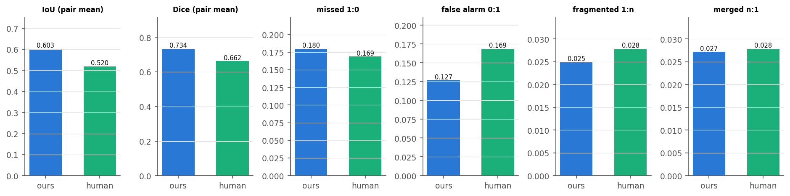
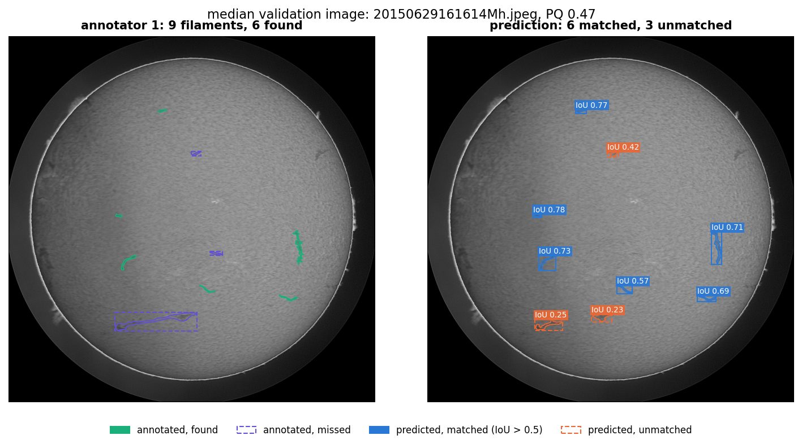
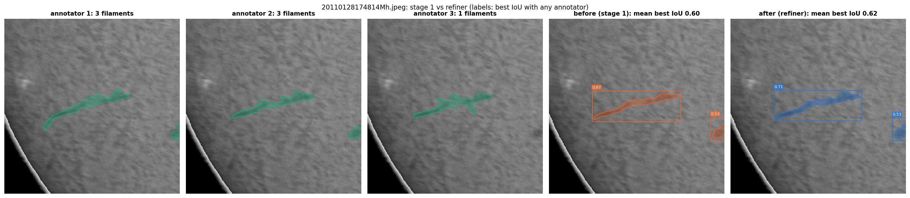

# Solar filament instance segmentation

Our entry to the IEEE / Kaggle **Solar Filament Segmentation Challenge 2026** ([competition](https://www.kaggle.com/competitions/filament-segmentation-2026)). The task is to find every solar filament in a GONG H-alpha full-disk image and return each one as a separate, pixel-disjoint mask.

**Team:**TeamP(ALOK RAI, Aditya kumar) · **Report:** `report.pdf` · **Leaderboard file:** produced by the committed notebook run (public LB 0.40)

**For the judges, where to look:**
- **Rubric against human agreement:** notebook Section 8, `figures/rubric_bars.png`, `figures/iou_pairs.png`, `figures/dice_pairs.png`.
- **Segmentations on H-alpha:** `figures/validation_best.png`, `validation_median.png` and `validation_worst.png` (with every annotator's outlines), `figures/refiner_example.png` (before and after stage 2), `figures/test_panel.png` and `figures/test_gallery.png` (test images).
- **The submission:** notebook Section 9 writes `outputs/submission.csv`.
- **Where the weights come from:** the table below, `training_notebooks/` and `provenance/`.

```
GONG H-alpha frame (2048 x 2048)
  -> 3 input channels at 1536 px                background-normalised intensity, CLAHE, dark-ridge response
  -> 3 U-Nets x 4-flip TTA, averaged            ConvNeXt-Tiny (DINOv3) encoder, full-resolution stem, mask + spine heads
  -> probability map -> connected components    p >= 0.60, >= 240 px
  -> learned keep/drop filter                   gradient-boosted trees on 15 per-instance features
  -> stage 2: refiner                           each kept filament re-segmented in its own crop at native 2048 px
  -> COCO-RLE submission
```

## Results

Fold 0: 141 held-out images with 1–3 annotators each. PQ is pooled over every annotator of an image, as in the competition metric.

| | Pooled PQ | IoU (overlapping pairs) | Dice | Missed | False alarms | Fragmented | Merged |
|---|---|---|---|---|---|---|---|
| One annotator scored against another (the 67 images with 2–3 annotators) | 0.350 | 0.520 | 0.662 | 16.9% | 16.9% | 2.8% | 2.8% |
| Stage 1 (ensemble + filter), all 141 images | 0.457 | 0.595 | 0.729 | 18.0% | 12.7% | 2.5% | 2.6% |
| **This system** (stage 1 + refiner), all 141 images | **0.468** | **0.603** | **0.734** | 18.0% | **12.7%** | **2.5%** | **2.7%** |

- **Like for like:** human agreement can only be measured on the 67 images with more than one annotator. On those images the system scores 0.464 [0.441, 0.487] against 0.350 [0.325, 0.377], a paired difference of +0.114 [+0.090, +0.136].
- **The refiner:** on the same 948 kept filaments it adds +0.011 PQ [+0.007, +0.014].
- Intervals are 95% bootstrap intervals over images. Every filtered number uses out-of-fold filter scores.
- **Public leaderboard:** 0.40 (stage 1 alone: 0.39).







## Quick start

```bash
git clone <this repository> && cd <repository>
conda create -n filament python=3.13 -y && conda activate filament     # Python 3.11-3.13
# On a GPU machine install the torch build that matches your driver first, e.g.
#   pip install torch==2.11.0 --index-url https://download.pytorch.org/whl/cu126   (or cu128 / cu130)
pip install -r requirements.txt
kaggle competitions download -c filament-segmentation-2026 -p data && unzip -q data/filament-segmentation-2026.zip -d data
jupyter lab solar_filament_pipeline.ipynb
# or headless:
#   jupyter nbconvert --to notebook --execute --ExecutePreprocessor.timeout=-1 solar_filament_pipeline.ipynb --output outputs/run.ipynb
```

The notebook looks for `MAGFiLO_1.0_Annotations_kaggle2026_train.json`, `train_images/` and `test_images/` at any depth under `FILAMENT_DATA`, `./data` or `../data`. The validation sections need the training images and annotations as well as the test images.

**A default run** needs no internet. It does the following:
1. Loads the shipped weights.
2. Reproduces the validation numbers from the stored fold-0 maps, refining the 948 kept validation filaments on the way (about 6 minutes; the crops are prepared on the CPU).
3. Segments all 180 test images into `outputs/submission.csv`.
4. Draws every figure into `outputs/figures/`.
5. Checks the ONNX export.

**Runtime.** On a Tesla T4 a default run takes about 45 minutes, most of it test inference: 10.0 s per image, of which the three networks take 6.9 s and the refiner 1.9 s. On a CPU, all 180 test images take about 3 hours; set `FILAMENT_MAX_TEST=3` for a 25-minute check.

**Tested on** Python 3.13.16, torch 2.11.0 with CUDA 13.0, and a Tesla T4 (16 GB), on Kaggle. `pytest tests/` runs the unit tests (CPU, no data needed).

**The committed notebook is not a default run.** It was executed on Kaggle with `FILAMENT_REPREDICT_VALIDATION=1 FILAMENT_REFIT_FILTER=1 FILAMENT_TRAINING=smoke FILAMENT_REFINER_TRAINING=full FILAMENT_SAVE_RELEASE=1`. That run took 4.7 h on two T4s and trained the shipped refiners itself.

| Switch (cell 1, or environment variable) | Default | Effect |
|---|---|---|
| `FILAMENT_DATA` | unset | folder holding the competition files |
| `FILAMENT_REPREDICT_VALIDATION` | off | recompute the 141 validation maps from the weights (GPU, ~18 min) and compare them with the stored ones |
| `FILAMENT_REFIT_FILTER` | off | refit the instance filter from the validation maps (CPU, ~10 min) |
| `FILAMENT_TRAINING` | `off` | `smoke` (3-minute end-to-end training check); `v24`, `v27` or `v31` (member recipes, 8–10 h on a T4); `student` (teacher–student on unlabelled frames). Training needs internet: it downloads the DINOv3 encoder from the Hugging Face hub (no token needed). |
| `FILAMENT_UNLABELLED` | unset | folder of unlabelled GONG frames for the `student` recipe |
| `FILAMENT_REFINER` | on | stage 2; off reproduces the stage-1 system (0.457) |
| `FILAMENT_REFINER_TRAINING` | `off` | `smoke` (two images, one epoch); `full` (the shipped recipe: maps of the 566 training images, 12,683 crops, 16 epochs per seed). `full` takes 3.3 h on two T4s (maps 71 min, crops 45 min, both seeds at once 82 min), holds about 5 GB of crops in memory and needs internet for the encoder weights. |
| `FILAMENT_REFINER_USE_TRAINED` | off | use refiners trained in this session (automatic after `full`) |
| `FILAMENT_SAVE_RELEASE` | off | write refitted or retrained files back into `weights/` and `artifacts/`, overwriting the shipped ones |
| `FILAMENT_RUN_TEST`, `FILAMENT_MAX_TEST` | on, all | skip test inference, or limit it to the first N images |
| `FILAMENT_MAX_VAL` | all | validate on the first N fold-0 images only |
| `FILAMENT_RUN_ONNX`, `FILAMENT_ONNX_IMAGES` | on, 3 | skip the ONNX section, or change how many images it compares |
| `FILAMENT_REPO`, `FILAMENT_WORK` | `.`, `./outputs` | repository and output folders |

## Repository

```
solar_filament_pipeline.ipynb   the whole pipeline, executed, with every figure (Section 7 can retrain the refiners)
figures/                        the figures of the committed run
training_notebooks/             the executed Kaggle notebooks that trained v24, v27 and v31, with a README
provenance/                     scripts and logs tying the weights to those runs and the package to the research code
filament/                       the code; one module per stage, short documented functions
  config.py          every setting, with the measurement behind it; training recipes
  data.py            competition files, COCO annotations, annotator records, medoid choice, folds
  preprocess.py      image -> 3 input channels
  model.py           FilamentUNet; fp16 weight files
  inference.py       TTA ensemble -> probability maps
  decode.py          probability map -> instances
  instance_filter.py features and the keep/drop filter, with its closed-form threshold
  refiner.py         stage 2: rotated native-resolution crops, consensus targets, paste-back, training
  metrics.py         pooled PQ, human-vs-human agreement, rubric statistics (IoU, Dice, 1:n, n:1)
  submission.py      RLE encoding and the host's checks
  augment.py, datasets.py, losses.py, training.py, pseudo_labels.py     training
  onnx_backend.py    ONNX export and ONNX Runtime inference
  maps.py, timing.py, viz.py, pipeline.py
weights/                        v24, v27, v31 and refiner_s0, refiner_s1 (fp16, 64 MB each),
                                instance_filter.pkl, MODELS.json (model cards)
artifacts/                      fold manifest, fold-0 ensemble maps (uint8), refined fold-0 instances (RLE),
                                training histories, run summary of the committed run, ONNX benchmark
tests/                          unit tests: pytest tests/
```

## Where every weight file comes from

| File | Produced by | Check |
|---|---|---|
| `weights/v24.fp16.pt`, `v27.fp16.pt`, `v31.fp16.pt` | versions 24, 27 and 31 of our research notebook on Kaggle ([`alok158/solar-filament`](https://www.kaggle.com/code/alok158/solar-filament)); the executed notebooks are in `training_notebooks/` | fingerprint in `MODELS.json`, checked on every load and against each version's output checkpoint (`provenance/verify_member_chain.py`) |
| `weights/refiner_s0.fp16.pt`, `refiner_s1.fp16.pt` | this repository's notebook, Section 7, in the committed run ([`alok158/solar-filament-release`](https://www.kaggle.com/code/alok158/solar-filament-release)) | fingerprint in `MODELS.json`, checked on every load |
| `weights/instance_filter.pkl` | this notebook, Section 6 (refit from the fold-0 maps) | its out-of-fold report is printed in Section 6 |
| `artifacts/fold0_maps.npz`, `fold0_refined.pkl` | this notebook, Sections 6 and 7 | compared with the stored copies on every re-prediction |

## Design in brief

Each choice below was adopted only if it beat seed noise (±0.004 PQ on fold 0) by our +0.005 bar. The docstrings in `filament/` give the reasoning and the measurement behind each one.

- **Input.** The whole disk is resized to 1536 px rather than tiled, because global context beat native-resolution tiles. Two of the three channels remove limb darkening and amplify thin dark ridges.
- **Model.** A ConvNeXt-Tiny encoder with DINOv3 initialisation feeds a U-Net decoder. A full-resolution stem keeps the 1–2 px edges, since the encoder's first features are at stride 4.
- **Loss.**
  - BCE.
  - Dice, half of it computed per instance, because the metric is per instance.
  - Skeleton Recall on the annotators' drawn spines.
  - A spine head trained as deep supervision.
- **Labels.** Images have 1–3 annotators, and the metric pools them all. Members train on the *medoid* annotator (the one who agrees most with the others), on a random annotator, or on a mix. Averaging the three members was the only change to the network that cleared the adoption bar.
- **Instances.** Instances are connected components, so they are disjoint by construction. Joining fragments across gaps raised merges above the human rate and was switched off.
- **Filter.** It predicts the share of annotators who would draw each candidate. A candidate is dropped when that share is below ½·PQ/SQ, which is exactly when dropping raises pooled PQ.
  - Effect: 0.422 → 0.457.
  - It is cross-fitted by observation date on the validation fold only.
- **Refiner (stage 2).** With perfect outlines for the kept filaments, fold-0 PQ would be 0.652, so the headroom is in the outlines rather than in which filaments are kept. Each kept filament gets a 128 × 384 crop at native resolution, rotated along its axis and long enough to show where it ends. Two refiners (seeds 0 and 1) predict the share of the filament's annotators who mark each pixel, from the image, the ensemble's maps, the filament and its kept neighbours.
  - Effect: 0.457 → 0.468 on the same 948 filaments; each seed alone reaches 0.466. Public leaderboard 0.39 → 0.40.
  - The experiment that adopted it trained a separate pair with the same recipe and measured 0.469, so the gain reproduces across training runs.
  - Trained only on crops from the 566 training images; the 0.40 pixel threshold was fixed before the experiment.
  - Decision-layer alternatives measured at the same time did not pay: candidate trees over 8 thresholds lost 0.002–0.012, and an expected-IoU target tied.
- **Unlabelled data.** A teacher–student student trained on soft pseudo-labels of 1375 unlabelled GONG frames from 2023–2026 gained +0.014 over its labelled-only control. It equals the 3-model ensemble at a third of the inference cost; it is documented and trainable here, and the ensemble ships.
- **Tried and rejected** (each with its measurement in the docstrings):
  - Mask2Former, wider and higher-resolution decoders, and a border head.
  - Soft annotator-mean targets.
  - Heavy augmentation.
  - Inference above 1536 px.
  - Fine-tuning after pseudo-label pretraining.
  - A fourth ensemble member.

## Rules

- **Inference** uses the test image alone: no file-name metadata and no neighbouring frames. All 15 filter features come from the image's own predicted maps.
- **Submission:** instances never overlap, and `submission.check_submission` asserts this before writing.
- **Unlabelled frames** are used for training only. They postdate the labelled set (2011–2022), so none is within an hour of a test image.

## Verification

1. **Equivalence with the original research code.** This package was refactored out of the research code that trained the members. On the same inputs it gives identical results for each of these (`provenance/check_release.log`):
   - input channels
   - network logits
   - decoded instances on all 141 validation maps
   - RLE, PQ and the medoid choice
   - augmentation and loss
   - the filter fit: same threshold, same PQ
2. **fp16 weights.** Storing the weights in fp16 moves the probabilities by at most 1.6e-6.
3. **Member weights.** Each member's checkpoint, downloaded again from the output of the Kaggle version that trained it, has the same fingerprint as the shipped file (`training_notebooks/checkpoint_chain.json`).
4. **Clean-copy run.** The committed notebook was executed from a clean copy of this repository on Kaggle (two Tesla T4s). That run:
   - re-predicted the validation maps from the shipped weights (at most 5/255 from the stored maps);
   - refit the filter (the same threshold and PQ as the stored filter);
   - ran the training smoke test for a member;
   - trained both refiners from scratch (Section 7, `full`: 12,683 crops, the same count as the experiment that adopted the refiner) and scored them: fold-0 PQ 0.4573 → 0.4679;
   - wrote the shipped `weights/refiner_s0.fp16.pt`, `refiner_s1.fp16.pt`, `weights/instance_filter.pkl`, `artifacts/fold0_maps.npz` and `artifacts/fold0_refined.pkl`;
   - segmented the 180 test images; that `submission.csv` is our final leaderboard submission (public LB 0.40).

## Licence and credits

- **Code:** MIT (`LICENSE`).
- **Weights:** the five networks are fine-tuned from Meta's DINOv3 ConvNeXt-Tiny (`convnext_tiny.dinov3_lvd1689m` in timm), so they are derivatives of DINOv3 and are distributed under the [DINOv3 License](https://ai.meta.com/resources/models-and-libraries/dinov3-license/). Built with DINOv3.
- **Data:** MAGFiLO, manually annotated filaments in GONG H-alpha observations (Ahmadzadeh et al., 2024). GONG data are provided by the NSO Integrated Synoptic Program (NISP).
